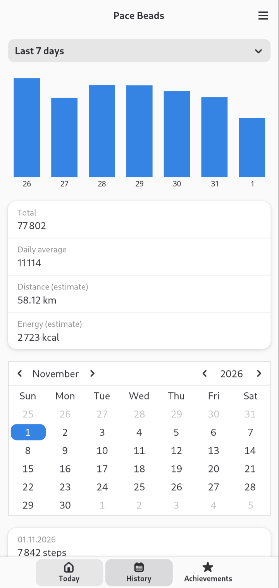
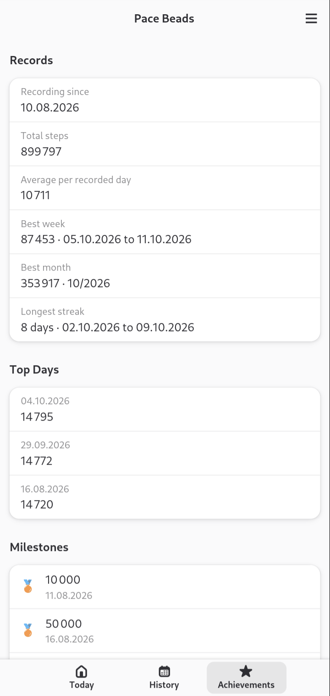
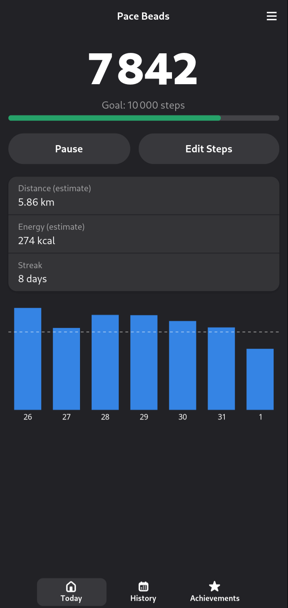
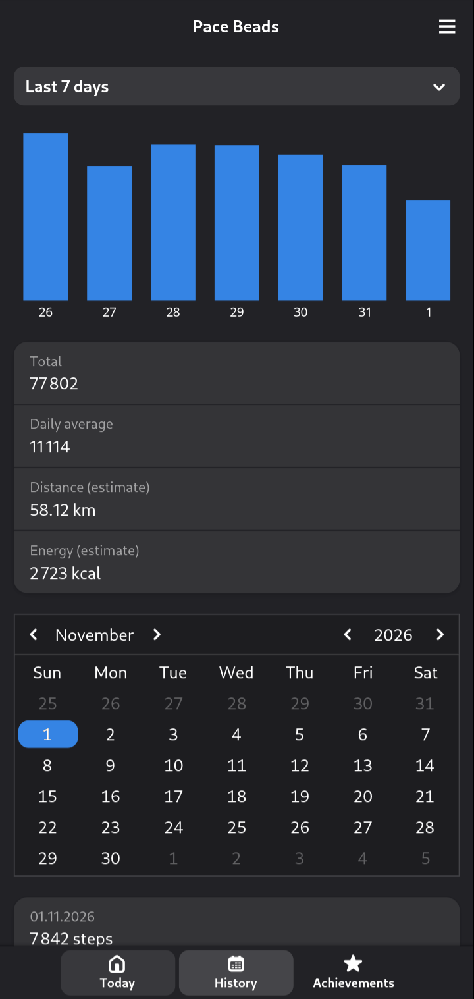
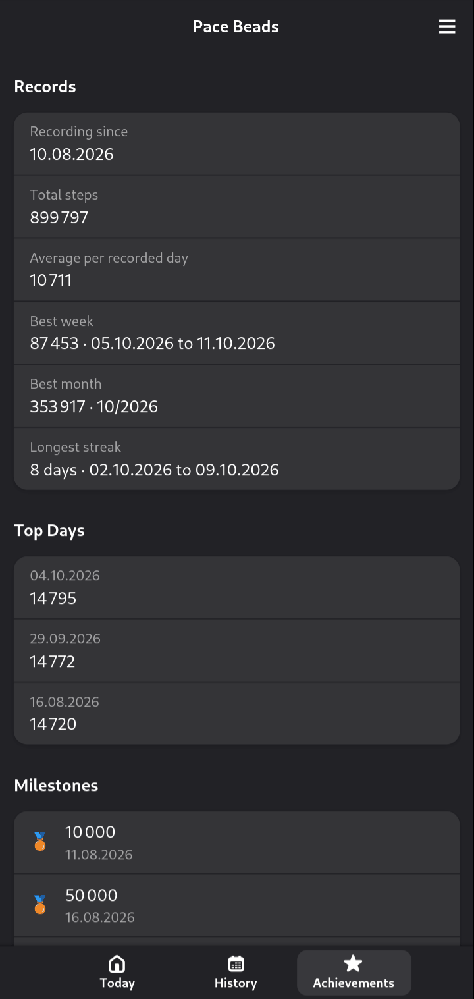
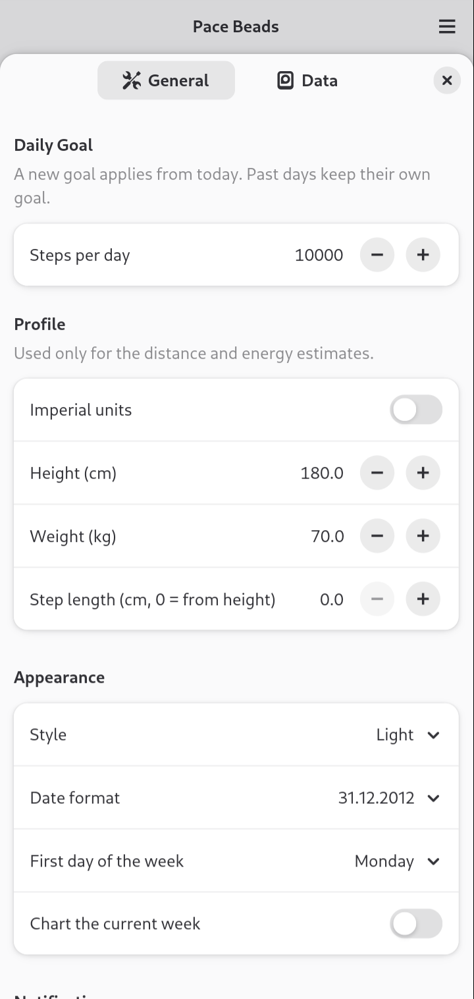
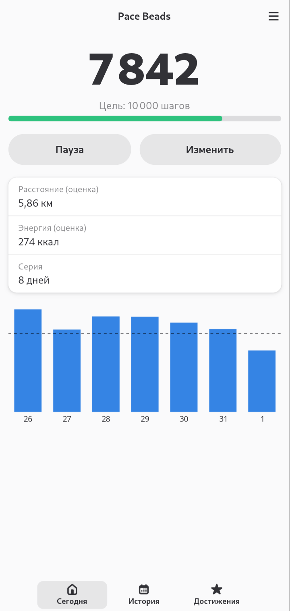

<div align="center">


# Pace Beads

**An offline step counter for Linux phones**

Daily goals · streaks · milestones · history charts · local backups

[](LICENSE)

[](https://github.com/x-vlad-x/pace-beads/releases)

</div>

Pace Beads counts your steps with the phone's hardware step counter and keeps
working while the window is closed. It is a native GTK 4 and libadwaita app
with a small background recorder. There is **no network access at all**: no
accounts, no telemetry, no cloud. Your history stays on the phone.

Built for and tested on the **FuriPhone FLX1s** running **FuriOS**.

> **Preview release.** This is the first public version. The count has only
> been checked against a manual count on three short walks. See
> [Known limitations](#known-limitations). Feedback is very welcome!

| | | |
|:-:|:-:|:-:|
|  |  |  |
| Today | History | Achievements |
|  |  |  |
| Dark theme | | |
|  |  |  |
| Preferences | Deutsch | Русский |

The screenshots show synthetic data on a real FLX1s.

## Features

- **Background recording.** The recorder reads the hardware counter through
  SensorFW, with or without the window open.
- **Goals and streaks.** Each day keeps the goal it had, so changing your goal
  does not rewrite the past.
- **Achievements.** Records, top days and milestones up to 20 million steps.
- **History.** Period totals and averages, charts and a calendar.
- **Estimates.** Distance and energy from your height, weight or step length,
  in metric or imperial units.
- **Pause and correction.** Pause for a while or until you resume, and correct
  today's total by hand.
- **Notifications.** Daily goal, encouragement during the day and new
  milestones, each with its own switch.
- **Your data stays yours.** CSV export and import, automatic local copies to a
  folder you choose, and import from a [Stepsy](https://github.com/nvllz/stepsy)
  database or CSV file.

## Privacy

Pace Beads makes no network connections and has no accounts, ads or telemetry.
It records daily totals in a local SQLite database under
`~/.local/share/pace-beads`. Location is not used.

## Install

On FuriOS, add the signed repository and install the package:

```sh
sudo install -d -m 0755 /etc/apt/keyrings
curl -fsSL https://deb.xvlad.com/xvlad.gpg | sudo tee /etc/apt/keyrings/xvlad.gpg >/dev/null
curl -fsSL https://deb.xvlad.com/xvlad.sources | sudo tee /etc/apt/sources.list.d/xvlad.sources >/dev/null
sudo apt update
sudo apt install pace-beads
```

Updates then arrive with `sudo apt upgrade`. The arm64 package is also attached
to each [release](https://github.com/x-vlad-x/pace-beads/releases).

The package needs `sensorfw-qt6` and its Hybris plugin from FuriOS, so it does
not install on plain Debian.

## Languages

The interface follows the system language: English, Deutsch and Русский. The
German translation has not been reviewed by a native speaker yet, so
corrections are very welcome.

To add a language, create `po/<language>.po` from `po/pace-beads.pot`. After
changing strings in the code, run `po/update.sh`; `po/update.sh --check`
verifies that catalogs are complete and their placeholders match.

## Known limitations

- **Accuracy is only roughly known.** In three short hand-counted walks with the
  phone in hand, the app reported 39 of 36, 40 of 39 and 59 of 60 steps. Longer
  walks and walks with the phone in a pocket have not been checked.
- **It may count fewer steps than other devices.** On one afternoon of walking
  with stops, the FLX1s reported 0.667 of the steps of a Pixel 9 Pro XL. Stepsy on the
  same FLX1s reported the same total, so the difference comes from the phone's
  step detector or from the Pixel, not from this app.
- **Short walks may be lost.** The detector did not report bursts of fewer than
  about 10 steps.
- **Steps are lost while the recorder or SensorFW is not running.** The sensor did
  not count without an active session: 56 and 51 hand-counted steps were not
  recovered after the recorder and `sensorfwd` were stopped. Counting resumed
  without intervention once they were back.
- **Battery use has not been measured.**
- **Real suspend is untested.** The test device did not suspend during testing.
- **Only FuriOS on the FLX1s is supported.**

## Building from source

You need Rust 1.85 or newer, the development files for GTK 4.16 and libadwaita
1.7, and GNU gettext.

```sh
cargo build --release
cargo test --workspace
```

`packaging/cross-build.sh` builds the arm64 binaries and the `.deb` in a Debian
forky container with an arm64 toolchain. Pass your image as its argument.

| Crate | Purpose |
| --- | --- |
| `pace-core` | Counting, history, statistics, import and backups; no user interface |
| `pace-recorder` | Background service that owns the sensor session and the database writes |
| `pace-ui` | GTK 4 and libadwaita interface |

The scenarios in `tests/e2e` run against a synthetic sensor.

## License and origins

Pace Beads is licensed under the [GNU GPL 3.0 only](LICENSE). See
[docs/LICENSING.md](docs/LICENSING.md) for details and the release assets for
third-party notices.

This is an independent, unofficial project written from scratch. Its behavior
was inspired by [Stepsy](https://github.com/nvllz/stepsy) by nvllz, which
acknowledges [MotionMate](https://github.com/0xf4b1/motionmate) by 0xf4b1. It
is not affiliated with those projects and contains no code from them.
